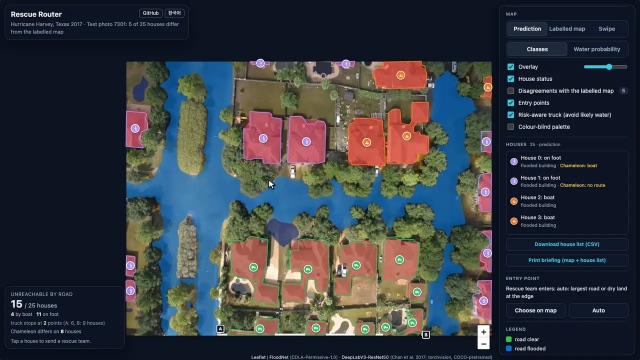
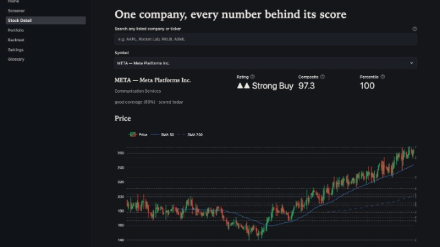
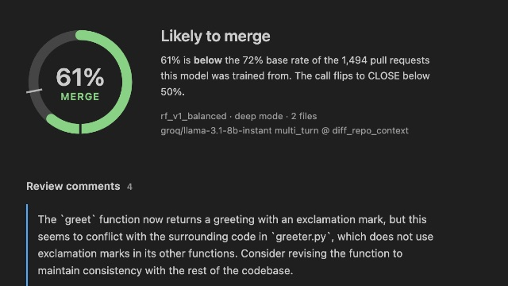
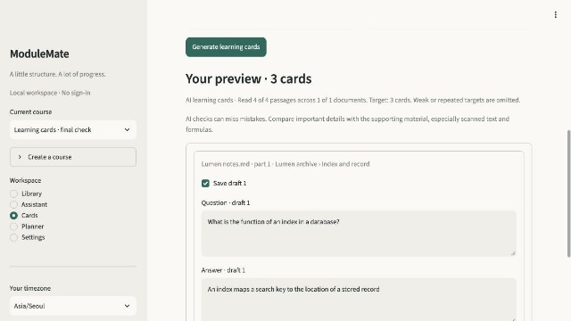

## Hi, I'm Marlen Melis

I study **AI Computing at KAIST** (B.S. 2026–2030, with an intended double major in Business & Technology
Management) and do undergraduate research in the **[Interactive Computing Lab](https://ic.kaist.ac.kr)** with
Prof. Uichin Lee. I build machine-learning systems end to end, from data collection to a working product, and I
care most about the evaluation: pre-registered comparisons, leakage checks, baselines and confidence intervals,
with the limits stated next to the numbers.

**Now:** researching how scholarly platforms control access for AI agents (separate `robots.txt` rules for training
crawlers, search crawlers and user-triggered fetchers) and what that means for AI-assisted literature search.

[LinkedIn](https://www.linkedin.com/in/marlenmelis) · [marlen.melis@kaist.ac.kr](mailto:marlen.melis@kaist.ac.kr) · Daejeon, South Korea

---

### Selected projects

**[Rescue Router](https://github.com/MarlenMM/rescue-router)** · [live viewer](https://marlenmm.github.io/rescue-router/)\
Flood maps from drone photos and truck → boat → on-foot rescue routes to every house, learned from 50 labelled
photos. A pre-registered comparison found that ordinary fine-tuning beats the course's few-shot generalist from
about 20 labels: **mIoU .617 vs .507** on all 448 FloodNet test photos, with houses wrongly shown as truck-reachable
falling from 11.1% to **6.8%**. A 13 MB model maps your own photo in the browser.\
PyTorch · torchvision · ONNX Runtime Web · Leaflet · JavaScript — KAIST AIC.20000, Fall 2026
 

**[QuantPulse](https://github.com/MarlenMM/quantpulse)** · [live demo](https://marlenmm.github.io/quantpulse/)\
A $0 equity-research and portfolio-construction engine for the S&P 500: eight free data sources, seven-category
composite scoring, walk-forward backtests with bootstrap confidence intervals, forecasts graded against a random
walk, and three portfolio optimisers (mean-variance, HRP, Black-Litterman). **21,000+ lines** of engine code and
**2,000+ tests**, including property-based ones; a scheduled pipeline refreshes the demo every weekday.\
Python · pandas · scikit-learn · statsmodels · FastAPI · React/TypeScript · SQLite — personal project, 2026
 

**[Code Review AI](https://github.com/MarlenMM/code-review-ai)**\
Can an LLM review pull requests better than a model trained on the project's history? I mined **1,494 PRs** from
five large open-source repositories, a quarter of them written by an AI agent, and ran four experiments. The best
LLM configuration **matched, not beat**, a Random Forest (93.75% accuracy, identical confusion matrix), and only the
self-reflection and multi-turn prompts ever caught a bad AI-written PR. Ships as a FastAPI backend and a VS Code
extension.\
Python · scikit-learn · LLM prompting · FastAPI · TypeScript — HIT Global Summer School, July 2026
 

**[Theme Worlds](https://github.com/MarlenMM/theme-worlds)** · [live viewer](https://marlenmm.github.io/theme-worlds/)\
Seamless 360° panoramas from stock Stable Diffusion v1.5 with a MultiDiffusion sampler written from scratch:
circular windows make the wrap-around a property of the sampling, and multi-branch conditioning avoids CLIP's
77-token truncation. Mean **seam ratio 1.12** over 28 panoramas against 7.94 without circular windows, with
byte-identical reruns.\
PyTorch · diffusers · CLIP — KAIST AIC.20000, Fall 2026
 

**[ModuleMate](https://github.com/MarlenMM/modulemate)**\
A local AI study workspace for your own notes, slides and scans: answers with inspectable sources, learning cards
bound to exact source spans, and a planner that turns dates in the material into editable calendar events. Runs a
quantised 9B model on Apple Silicon with local OCR, and adds its own trained relevance, answerability and ranking
heads; 480 tests.\
Python · MLX · sentence-transformers · SQLite FTS5 · Streamlit — began as a HIT Summer School project, course grade 97/100
 

### Research and writing

- **Undergraduate researcher**, Interactive Computing Lab, KAIST (Sep 2026 – present): *Agent Access for Research*.
- **Sole-author journal article**: "How Did Personal Loans Influence the Well-Being of Financially Unstable Families in
  Kazakhstan Over the Last Five Years?", *Central Asian Scientific Journal* 4(23), pp. 12–21, 2024 (in Kazakh).
  A 101-respondent survey and two semi-structured interviews, designed, run and analysed alone.

### Education

- **KAIST**, B.S. in AI Computing, 2026 – present
- **Harbin Institute of Technology**, Global Summer School, July 2026: AI & Machine Learning (97/100), Basics of
  Machine Learning (91/100), Intelligent Software Engineering practice (90/100)

### Toolkit

**Languages:** Python, TypeScript, JavaScript, SQL, C/C++\
**ML:** PyTorch, diffusers, scikit-learn, statsmodels, sentence-transformers, FAISS, MLX, ONNX Runtime\
**Systems:** FastAPI, SQLAlchemy/Alembic, React, Streamlit, Gradio, SQLite, GitHub Actions\
**Practice:** pytest, Hypothesis, Playwright, ruff, mypy, pre-registration, bootstrap confidence intervals\
**Spoken:** English (IELTS 8.0), Kazakh and Russian (native)
